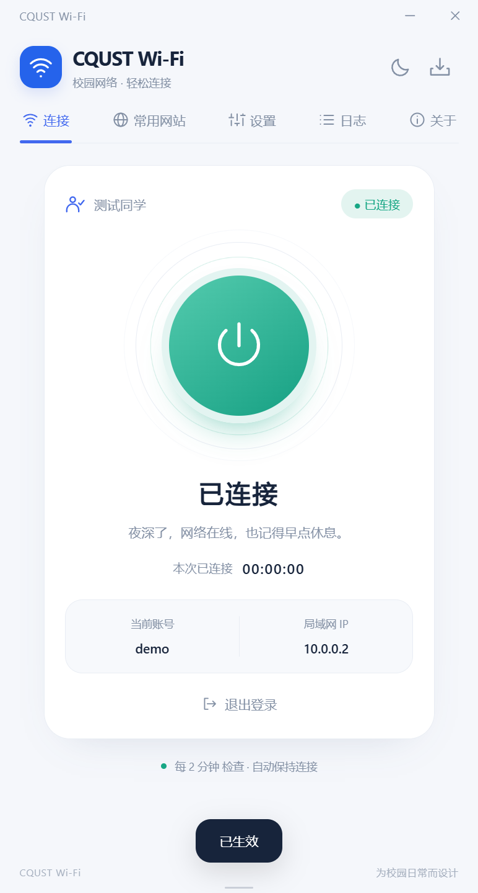
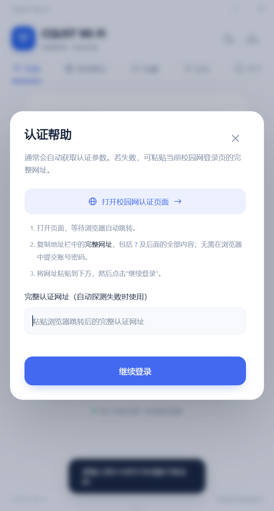

# CQUST Wi-Fi

重庆科技大学校园网客户端。当前 Windows 版本：**v5.2.0**，使用 **Tauri 2 + Rust**；保留 macOS Apple Silicon 源码支持，本次未在 Mac 上构建或验证。

## v5.2.0 更新

- 修复吸附动画修改原生裁剪区域导致的边框残留；吸附默认关闭，从旧版升级时一次性关闭，之后可以自行开启。
- 关于页新增“加入内测群”，原“软件介绍与下载”改为“软件介绍”。
- “常用网站”之后新增默认关闭的代理页：HTTP / HTTPS CONNECT、SOCKS5 TCP / UDP，支持仅本机或局域网访问。
- 局域网客户端无需填写 IP 白名单。代理强制使用独立用户名和密码，支持自定义密码及推荐 12 位短密码；不保存密码，不自动恢复代理。
- 不修改系统代理或防火墙，不提供透明代理、TUN / VPN 或 Android 端。使用说明与边界见 [代理说明](docs/PROXY.md)。

[软件介绍与下载](https://cqust-wifi.ziyis.cn/)

本项目为非官方工具，不代表学校。需要连接学校校园网，且使用本人有权限的账号。

## 下载与安装

- [Windows v5.2.0](https://github.com/Hercules-Zhaoziyi/CQUST-WiFi/releases/tag/v5.2.0)
- [全部历史版本](https://github.com/Hercules-Zhaoziyi/CQUST-WiFi/releases)
- [版本索引与架构演进](docs/HISTORY.md)

每个 Release 提供对应 Windows EXE、源码 ZIP 和 `SHA256SUMS.txt`。安装器未签名，Windows 可能提示未知发行者。升级前请在系统托盘菜单中完全退出旧版，再运行安装包。

历史版本仅供归档，建议日常使用最新版本。不要在公开 Issue 中粘贴密码、验证码、完整认证网址、Cookie 或 `userIndex`。

## 功能

- 手动登录、自动登录、内嵌账号管理与系统安全凭据存储（Windows 凭据管理器或 macOS 钥匙串）。
- 圆形连接按钮、连接状态检测、可选静默重连、IP 与单次连接时长。
- 自动探测认证入口：HTTP 跳转失败后使用隔离的系统 WebView 执行网页动态跳转；必要时保留手动填入引导。
- 同网络切换账号保留进程内入口提示，重新获取页面和公钥，不重用旧登录请求或会话。
- CAPTCHA 图片显示和会话内刷新，由用户手动填写；不绕过验证码。
- 亮暗主题、动效、开机自启、系统托盘、实时日志。
- 20 项本地化图标的校园常用网站。
- Windows 固定窄窗口宽度；macOS 可调整窗口宽度。底部拉柄可调整高度，导航固定，滚动条自动隐藏。
- Windows 可即时开关屏幕工作区边缘吸附，默认关闭；macOS 不启用吸附。
- 设置底部的 GitHub 正式版更新检测、安全 Markdown 更新简介与新安装包下载。

## v5.1.1 更新

更新检测移回设置底部，更新简介支持标题、列表、代码块、表格和链接；使用本地解析与净化，不执行脚本、不加载远程图片。窗口贴边自动收起，悬停边缘平滑滑出，拖离即可解除；关闭吸附和托盘恢复均可回到屏内。v5.1.0 保留不变。

## v5.1.0 更新

补全浏览器动态认证跳转，避免仅靠简单重定向解析；退出账号不再清除同网络入口探测提示。修复 WebView2 与应用重复显示密码眼睛的问题。新增窗口吸附、GitHub 更新检测和关于页官网下载按钮。

浏览器探测不接收密码，也不读取系统浏览器的已保存账号或 Cookie。认证网址仅存在内存，网络 IP 改变即失效，失败时仍可使用认证帮助。真实账号认证受当前校园网络、账号权限与验证码要求影响；隔离测试通过不等于已完成另一个真实账号登录。

## 界面预览

以下截图使用隔离测试账号与虚构网络信息，不包含实际校园网账号。





## 源码结构

```text
ui/                         HTML、CSS、JavaScript、SVG 与本地图片
src-tauri/                  Rust 认证、凭据、窗口和系统托盘后端
verification/               隔离原生界面验证与协议测试向量
legacy/python-v3.2.0/       最后一个 Python GUI 版本
legacy/electron-v4.1.0/     最后一个 Electron 版本
docs/                       版本、安全说明与验证记录
```

全部 10 个版本的准确源码快照另见 Git 标签 `v1.0.0` 至 `v5.0.2`，以及各 Release 的源码 ZIP。历史版本在本次发布时导入，Git 提交时间不是原始开发日期。初始未标号 GUI 文件使用 `v1.0.0` 作为归档标签。

## 从源码构建

### Windows

需要 Windows x64、Node.js/npm、Rust stable MSVC 工具链、Visual Studio C++ Build Tools 和 Windows SDK。运行时使用系统 WebView2；缺少时安装器可引导安装。

```powershell
npm ci
cargo test --release --manifest-path src-tauri/Cargo.toml
npm run build
```

安装器位于 `src-tauri/target/release/bundle/nsis/`。`build-local.ps1` 可使用已配置的本机工具链；仓库不包含工具链缓存、`node_modules` 或构建产物。

### macOS Apple Silicon

需要 Node.js/npm、Rust stable 的 `aarch64-apple-darwin` 目标及 Xcode Command Line Tools。在 Mac 上运行：

```sh
npm ci
cargo test --locked --manifest-path src-tauri/Cargo.toml
npm run build:macos
```

产物位于 `src-tauri/target/aarch64-apple-darwin/release/bundle/` 下的 `macos/` 和 `dmg/`。macOS 密码保存在钥匙串；登录启动项写入当前用户的 `~/Library/LaunchAgents`，应在将应用移入最终安装位置后开启。此本地构建未使用 Developer ID 签名或公证，分发前仍需完成签名、公证及真实校园网登录验证。

macOS 关闭窗口后仍在后台运行。点击菜单栏的 CQUST 图标可重新打开窗口，右键可打开“显示主窗口 / 退出软件”菜单；点击 Dock 中的应用图标也可恢复窗口。macOS 不显示或运行窗口贴边吸附设置。

仅用于隔离界面验证的 `verify-ui` 功能不应加入发布构建。正式发布使用默认 features；验证模式不会操作真实用户配置、启动项或校园账号。

## 安全与归档

密码由系统安全凭据存储保存，认证参数不进入公开源码。发布前对源码、安装器内层文件和 PyInstaller 解压成员做已知凭据及令牌模式检查，详见 [安全说明](docs/SECURITY.md) 和 [本次审计记录](docs/RELEASE_AUDIT.json)。检查不等于完整安全审计。

本次验证：10 项 Rust 测试与 45 项原生 Tauri 界面检查通过。没有为公开发布断开真实校园网或代用户提交账号密码。

## 作者与鸣谢

@ 十七号旅客 · [ziyis.cn](https://ziyis.cn) · [GitHub](https://github.com/Hercules-Zhaoziyi)

感谢 [AutoLogin](https://github.com/Gloridust/RuijieWIFI-AutoLogin) 项目提供的锐捷认证脚本。

校徽、校园门户图标和小红书标识用于界面识别，第三方权利与原有声明不因本仓库公开而改变。详见 [第三方说明](docs/THIRD_PARTY_NOTICES.md)。此批归档未额外添加统一开源许可证。
